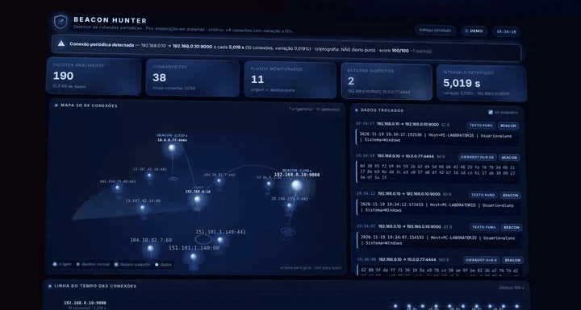
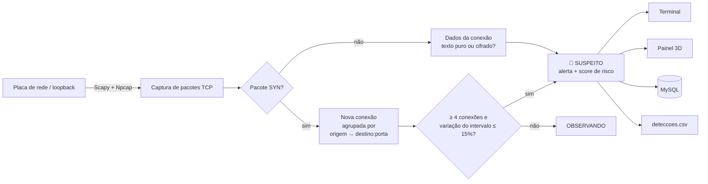
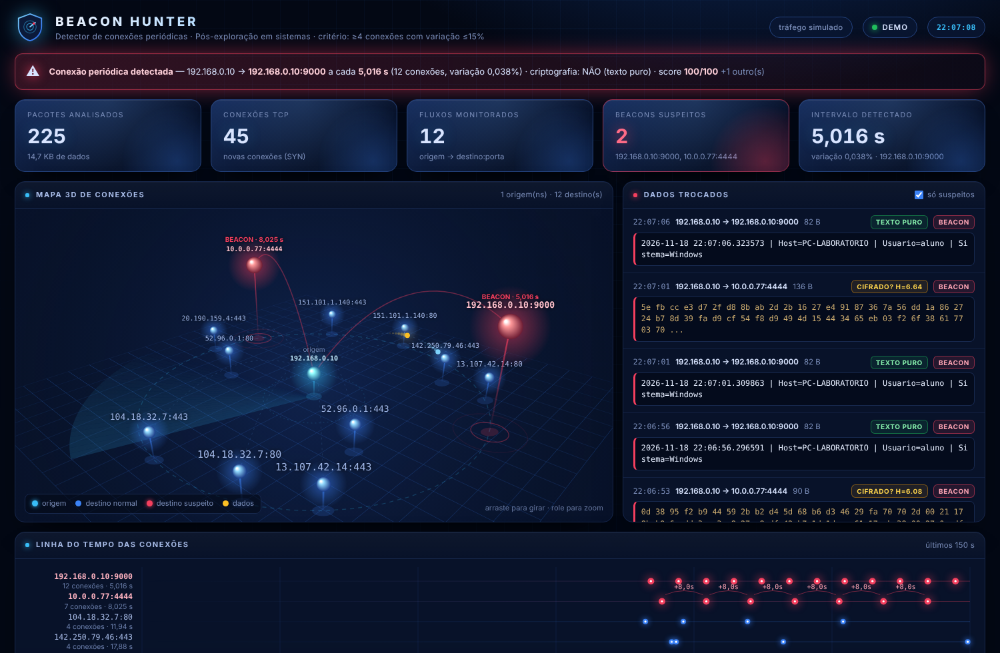
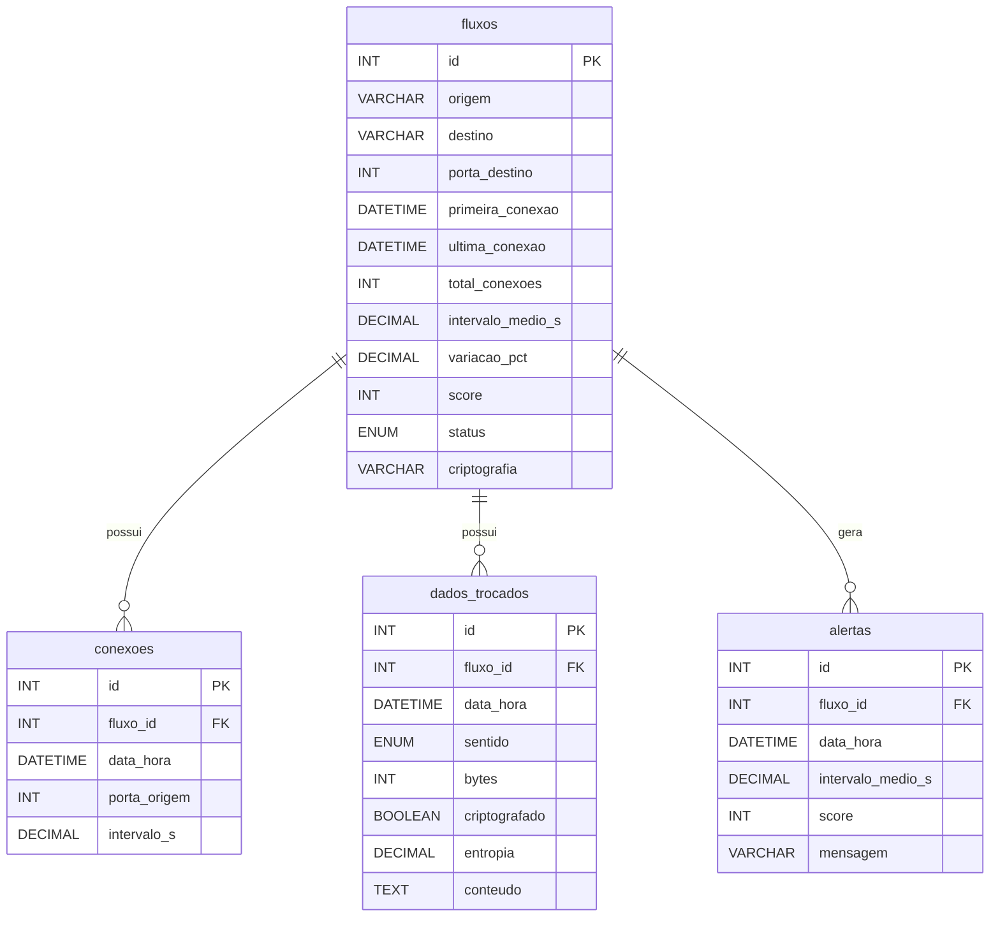

<p align="center">
  
</p>

<p align="center">
  Detector de <b>beaconing</b> (conexões periódicas de backdoors) escrito em Python,<br>
  com <b>painel visual 3D</b> no navegador e gravação das evidências em <b>MySQL</b>.
</p>

<p align="center">
  
  
  
  
</p>

<p align="center">
  <sub>Projeto desenvolvido na disciplina <b>Pós-exploração em Sistemas</b> do Curso Superior de Tecnologia em Segurança Cibernética — Faculdade SENAI "Paulo Antonio Skaf" (São Caetano do Sul/SP).</sub>
</p>

<p align="center">
  
</p>
<p align="center">
  <sub>Painel em funcionamento no modo de demonstração (<code>--demo</code>), com tráfego simulado: um beacon em texto puro na porta 9000 e outro cifrado na porta 4444.<br>Nesta animação as cores foram trocadas para azul; no painel real, os fluxos suspeitos aparecem em vermelho.</sub>
</p>

---

## 📌 Sumário

- [O problema](#-o-problema)
- [Como o detector funciona](#-como-o-detector-funciona)
- [Estrutura do repositório](#-estrutura-do-repositório)
- [Requisitos](#-requisitos)
- [Instalação](#-instalação)
- [Como usar](#-como-usar)
- [Opções da linha de comando](#-opções-da-linha-de-comando)
- [Painel visual](#-painel-visual)
- [Banco de dados MySQL](#-banco-de-dados-mysql)
- [Resultados obtidos](#-resultados-obtidos)
- [Limitações](#-limitações)
- [Aviso legal](#-aviso-legal)
- [Autora](#-autora)

---

## 🎯 O problema

Depois de invadir uma máquina (pós-exploração), o atacante quer **manter o acesso**. Uma técnica comum é deixar um programa que, de tempos em tempos, abre uma **conexão reversa** para o servidor do atacante ("liga para casa") — o chamado **beacon**. Como a conexão parte de dentro da rede, ela costuma passar pelo firewall.

Mesmo quando o conteúdo é **criptografado** (Meterpreter RC4/HTTPS, SBD etc.), o **comportamento** continua visível: conexões para o mesmo destino, em **intervalos quase idênticos**. É esse padrão que o Beacon Hunter procura.

> A criptografia esconde o **conteúdo**, mas não esconde o **comportamento**.

O laboratório usa dois scripts fornecidos pelo professor:

| Script | Papel | O que faz |
|---|---|---|
| `laboratorio/script1.py` | Máquina "comprometida" | A cada **30 s** abre uma conexão TCP para a porta **9000** e envia nome da máquina, usuário e sistema operacional, em texto puro |
| `laboratorio/script2.py` | Servidor do "atacante" | Escuta a porta **9000** e imprime tudo o que recebe |

---

## 🔍 Como o detector funciona



1. **Captura** os pacotes TCP da máquina (interface de loopback + interface principal).
2. Cada pacote **SYN** marca uma **nova conexão**. As conexões são agrupadas por **(IP de origem, IP de destino, porta de destino)**, já que a porta de origem muda a cada conexão.
3. Para cada grupo (**fluxo**) calcula o **intervalo médio** entre conexões e a **variação** (coeficiente de variação = desvio padrão ÷ média).
4. Um fluxo vira **SUSPEITO** quando tem **pelo menos 4 conexões**, intervalo médio entre **5 s e 1 h** e **variação de até 15%**.
5. O conteúdo de cada pacote é analisado: proporção de caracteres imprimíveis (texto puro?) e **entropia de Shannon** (provável criptografia?).
6. Um **score de risco (0–100)** soma a regularidade, a quantidade de conexões, o uso de porta incomum e a presença de dados do sistema em texto puro.

Exemplo de saída no terminal (modo `--demo`):

```text
══════════════════════════════════════════════════════════════════════════
  ⚠  ALERTA — CONEXÃO PERIÓDICA DETECTADA (possível backdoor / beacon)
══════════════════════════════════════════════════════════════════════════
   Origem ............ 192.168.0.10  (portas efêmeras: 56715, 58054, 57022, 52009...)
   Destino ........... 192.168.0.10:9000
   Conexões .......... 4
   Intervalo médio ... 5.016 s   (desvio 1.1 ms, variação 0.023%)
   Criptografia ...... NÃO (texto puro)
   Score de risco .... 88/100  (4 conexões a cada ~5.0s; variação de apenas 0.02%; porta incomum (9000); dados do sistema em texto puro)
   Histórico de conexões e dados trocados:
     #1   22:06:11.151  192.168.0.10:56715 → 192.168.0.10:9000
          → 82 B [texto puro] 2026-11-18 22:06:11.151067 | Host=PC-LABORATORIO | Usuario=aluno | Sistema=Windows
     ...
[22:06:31] BEACON   #5   192.168.0.10:57076 → 192.168.0.10:9000  +5.020s
[22:06:31] DADOS   → 82 B [texto puro] 2026-11-18 22:06:31.218458 | Host=PC-LABORATORIO | Usuario=aluno | Sistema=Windows
```

---

## 📁 Estrutura do repositório

```text
beacon-hunter/
├── detector.py          # detector (captura, análise, terminal, painel, CSV e MySQL)
├── painel.html          # painel visual 3D (servido pelo detector em http://127.0.0.1:8765)
├── requirements.txt     # dependências Python
├── laboratorio/
│   ├── script1.py       # "vítima": envia dados a cada 30 s (fornecido pelo professor)
│   └── script2.py       # "atacante": recebe os dados na porta 9000 (fornecido pelo professor)
├── sql/
│   ├── banco.sql        # criação do banco beacon_hunter e das 4 tabelas
│   └── consultas.sql    # 14 consultas de análise (MIN, MAX, COUNT, SUM, WHERE, GROUP BY, ORDER BY, subconsultas)
└── docs/
    ├── banner.svg       # título animado do README
    ├── painel-3d.gif    # animação do painel
    └── painel.png       # imagem do painel
```

---

## 📋 Requisitos

| Item | Para quê |
|---|---|
| **Python 3.10+** | Executar o detector e os scripts |
| **Npcap** (instalado junto com o Wireshark no Windows) | Captura de pacotes, inclusive na interface de loopback |
| **scapy** | Captura ao vivo |
| **mysql-connector-python** | Gravação no MySQL (opcional, opção `--mysql`) |
| **MySQL Server 8.0** | Banco de dados (opcional) |

> Os modos `--pcap` (analisar uma captura do Wireshark) e `--demo` (tráfego simulado) funcionam **sem** scapy e sem Npcap.

---

## 📦 Instalação

```powershell
git clone https://github.com/lauramendesteixeira/beacon-hunter.git
cd beacon-hunter
python -m pip install -r requirements.txt
```

---

## 🚀 Como usar

### 1. Laboratório completo (3 terminais)

No `laboratorio/script1.py`, ajuste a variável `SERVIDOR` para o IP da máquina onde roda o `script2.py` (veja com `ipconfig`). Para testar tudo em uma única máquina, pode deixar `127.0.0.1`.

```powershell
# Terminal 1 — servidor (rode primeiro)
python laboratorio\script2.py

# Terminal 2 — detector (de preferência como Administrador)
python detector.py

# Terminal 3 — máquina "comprometida"
python laboratorio\script1.py
```

O painel abre sozinho no navegador. O alerta aparece na **4ª conexão** do `script1.py` (cerca de 1min30s depois do início).

### 2. Gravando no MySQL

```powershell
python detector.py --mysql
```

A senha é pedida no terminal (não aparece ao digitar) e **não fica salva no código**. Também é possível usar a variável de ambiente `MYSQL_SENHA`. O banco e as tabelas são criados automaticamente se não existirem.

### 3. Analisando uma captura do Wireshark

```powershell
python detector.py --pcap captura.pcapng              # reproduz a 10x, com painel
python detector.py --pcap captura.pcapng --velocidade 0   # instantâneo
```

Aceita `.pcap` e `.pcapng` (Ethernet, loopback do Npcap e IP cru).

### 4. Demonstração sem captura

```powershell
python detector.py --demo
```

Gera tráfego simulado com dois beacons (um em texto puro e um com dados aleatórios, simulando criptografia) e conexões HTTPS comuns como ruído.

---

## 🔧 Opções da linha de comando

| Opção | Padrão | Descrição |
|---|---|---|
| `--pcap ARQUIVO` | — | Analisa um `.pcap`/`.pcapng` em vez de capturar ao vivo |
| `--velocidade N` | `10` | Velocidade da reprodução do pcap (`0` = instantâneo) |
| `--demo` | — | Tráfego simulado |
| `--iface NOME` | loopback + principal | Interface de captura (pode repetir) |
| `--listar-interfaces` | — | Lista as interfaces disponíveis e sai |
| `--min-conexoes N` | `4` | Conexões mínimas para avaliar o padrão |
| `--tolerancia X` | `0.15` | Variação máxima do intervalo (0.15 = 15%) |
| `--intervalo-min S` | `5` | Ignora repetições mais rápidas que S segundos |
| `--intervalo-max S` | `3600` | Ignora intervalos maiores que S segundos |
| `--ignorar PORTA ...` | — | Portas que não devem ser analisadas |
| `--csv ARQUIVO` | `deteccoes.csv` | Arquivo de registro (`""` desativa) |
| `--porta-web N` | `8765` | Porta do painel |
| `--sem-painel` / `--sem-navegador` | — | Não inicia o painel / não abre o navegador |
| `--mysql` | — | Grava no MySQL |
| `--mysql-host`, `--mysql-porta`, `--mysql-usuario`, `--mysql-banco` | `localhost`, `3306`, `root`, `beacon_hunter` | Conexão com o MySQL |
| `-v` | — | Mostra todas as conexões, não só as suspeitas |

O detector ignora automaticamente o tráfego do **próprio painel** e das **gravações no MySQL**, para não analisar a si mesmo.

---

## 📊 Painel visual

Servido pelo próprio detector em `http://127.0.0.1:8765` (sem bibliotecas externas — HTML, CSS e Canvas puros):


<sub>Painel em modo de demonstração (`--demo`), com tráfego simulado: um beacon em texto puro na porta 9000 e outro cifrado na porta 4444.</sub>

- **Alerta** em destaque quando um beacon é detectado;
- **Indicadores**: pacotes analisados, conexões, fluxos, beacons suspeitos e intervalo detectado;
- **Mapa 3D** das conexões (arraste para girar, role para zoom), com partículas animadas a cada conexão e a cada envio de dados;
- **Dados trocados**: o conteúdo de cada envio, marcado como texto puro ou provável cifra;
- **Linha do tempo**: as conexões de cada fluxo e o intervalo entre elas — o ritmo do beacon fica evidente;
- **Tabela de fluxos** ordenada por risco, com status, intervalo médio, variação, criptografia, score e motivos.

---

## 💾 Banco de dados MySQL

Banco **`beacon_hunter`** (script em [`sql/banco.sql`](sql/banco.sql)):



| Tabela | Conteúdo |
|---|---|
| `fluxos` | Cada destino monitorado (origem → destino:porta) com estatísticas, score e status |
| `conexoes` | Cada nova conexão (SYN), com porta de origem e intervalo desde a anterior |
| `dados_trocados` | O conteúdo transmitido, sentido, tamanho, entropia e se parece cifrado |
| `alertas` | Os alertas de conexão periódica |

Detalhes da gravação:

- as gravações vão para uma **fila** e são feitas por uma **thread** separada, para não atrasar a captura;
- os fluxos usam `INSERT ... ON DUPLICATE KEY UPDATE`, então cada destino tem uma única linha atualizada;
- todos os comandos usam **parâmetros** (`%s`), evitando SQL Injection — importante, já que o conteúdo gravado vem da rede.

O arquivo [`sql/consultas.sql`](sql/consultas.sql) traz **14 consultas** de análise:

| # | Consulta | Recursos |
|---|---|---|
| 1 | Conexões por fluxo | COUNT, GROUP BY, ORDER BY |
| 2 | Fluxos suspeitos | WHERE |
| 3 | Primeira/última conexão e duração do beacon | MIN, MAX, COUNT, WHERE |
| 4 | Regularidade do intervalo | MIN, MAX, AVG, WHERE |
| 5 | Volume de dados por fluxo | COUNT, SUM, GROUP BY, ORDER BY |
| 6 | Vazamento de dados em texto puro | WHERE, LIKE, ORDER BY |
| 7 | Texto puro × cifrado | COUNT, SUM, GROUP BY |
| 8 | Fluxo com maior score | MAX, subconsulta escalar |
| 9 | Conteúdo dos fluxos com alerta | subconsulta `IN` |
| 10 | Intervalos acima da média do fluxo | subconsulta correlacionada |
| 11 | Destinos acima da média de conexões | COUNT, GROUP BY, HAVING, subconsulta |
| 12 | Conexões por minuto | COUNT, GROUP BY, ORDER BY |
| 13 | Mensagens por sentido | MIN, MAX, COUNT, SUM, GROUP BY |
| 14 | Histórico de alertas | JOIN, ORDER BY |

---

## 📈 Resultados obtidos

Em laboratório (Windows, captura ao vivo por cerca de 7 minutos, com o `script1.py` enviando a cada 30 s):

| Medida | Resultado |
|---|---|
| Pacotes analisados | 29.463 |
| Conexões TCP / fluxos | 475 / 42 |
| Fluxos classificados como suspeitos | **1** — o `script1.py` |
| Conexões do beacon | 14 em 390 s |
| Intervalo | **30,003 s a 30,006 s** (média 30,004 s, variação de 0,004%) |
| Tamanho de cada envio | 88 bytes |
| Criptografia | **não** — usuário, máquina e sistema operacional em texto puro |
| Score de risco | **100/100** |
| Momento do alerta | 4ª conexão (critério mínimo) |

Outros fluxos com muitas conexões — como consultas DNS (porta 53, variação de 211%) e serviços locais — **não** foram classificados como suspeitos, porque não tinham intervalo regular.

Os resultados foram **validados no Wireshark** (filtro `tcp.port == 9000`): cada envio gera 9 pacotes TCP (SYN, SYN/ACK, ACK, PSH/ACK com os dados, ACK e o encerramento com FIN), e os horários, portas de origem e conteúdos coincidem com os registros do banco, com diferença de cerca de 1 ms.

---

## 🚧 Limitações

- Analisa apenas **TCP** e considera como "nova conexão" o pacote SYN. Beacons que reaproveitam uma única conexão aberta (ou usam UDP/DNS) não são detectados por esta versão.
- Beacons com **jitter** alto (intervalo aleatório proposital) podem passar do limite de 15% de variação — o valor pode ser ajustado com `--tolerancia`.
- A identificação de criptografia é uma **estimativa** por entropia; mensagens muito curtas ficam como "indefinido".
- A captura ao vivo pode exigir **privilégios de administrador**, dependendo de como o Npcap foi instalado.

---

## 📜 Aviso legal

Projeto **educacional**, desenvolvido para estudar técnicas de pós-exploração e, principalmente, como **detectá-las**. Execute os scripts de laboratório apenas em máquinas e redes **suas ou com autorização**. O detector apenas observa o tráfego da própria máquina.

---

## 👩‍💻 Autora

**Laura Mendes Teixeira**
Curso Superior de Tecnologia em Segurança Cibernética — Faculdade SENAI "Paulo Antonio Skaf"
Disciplina: Pós-exploração em Sistemas — Prof. Paulo Alexandre Martin

Os scripts da pasta `laboratorio/` foram fornecidos pelo professor como parte da atividade.
